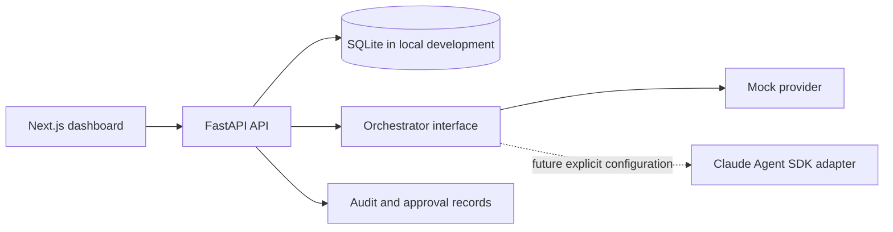

# Platform foundation specification

**Status:** Proposed  
**Scope:** First runnable vertical slice only  
**Source:** Supplied master prompt, sections 4, 5, 7, 10, 15, and 16

## Business requirement

Learners and engineering teams need a local, inspectable way to submit a business requirement, produce a transparent proposed engineering workflow, and approve or reject it without implying that a real Claude agent ran when a mock provider was used.

## Functional requirements

1. A user can create and list projects and business requirements.
2. A user can request a proposed technical specification and implementation plan for a requirement.
3. The system records the execution provider (`mock` or a later real provider), status, timestamps, result payload, and errors.
4. A user can approve or reject a proposed change; rejection requires a reason.
5. The API exposes health, projects, requirements, executions, and approvals through typed REST contracts.
6. The UI presents loading, empty, error, and provider-labelling states.

## Non-functional requirements

- Local development uses SQLite; database access is behind SQLAlchemy models and migrations/initialisation code.
- The backend uses FastAPI, Pydantic validation, and explicit error responses.
- The frontend uses Next.js, TypeScript, Tailwind CSS, and accessible controls.
- No API keys, secrets, or GitHub tokens are committed. Real provider execution is disabled unless explicitly configured.
- The first slice has unit tests for domain/API contracts and a smoke test for the primary submission-to-approval path.
- Audit records redact sensitive input fields and never claim mock work was real Claude execution.

## User stories and acceptance criteria

| ID | Story | Acceptance criteria |
|---|---|---|
| US-001 | As a product owner, I submit a requirement. | Required title and description are validated; a persisted record is returned with a stable ID. |
| US-002 | As an engineer, I generate a proposed plan. | Execution is persisted, streamed/polled as appropriate, and labelled `Mock execution` when using the mock provider. |
| US-003 | As a reviewer, I approve or reject a proposal. | Approval creates an immutable decision record; rejection cannot be submitted without a reason. |
| US-004 | As an auditor, I inspect activity. | The system shows status/timing/provider metadata without fabricated token, cost, or test metrics. |

## Technical design

Initial entities: `Project`, `Requirement`, `Execution`, `Approval`, and `AuditEvent`. The provider adapter returns a typed proposal. A mock adapter uses deterministic fixture data only and includes `provider=mock`; no token/cost fields are populated unless measured by an enabled real provider.

## Implementation tasks

1. Add root workspace tooling and reproducible local setup documentation.
2. Create FastAPI application, configuration, database session, models, schemas, and health endpoint.
3. Implement project/requirement/execution/approval routes and mock-provider adapter.
4. Create accessible frontend shell and requirement/approval views.
5. Add tests, lint/type checks, CI, and a development Docker Compose path.
6. Update traceability and state documents with exact test outcomes.

## Test cases

| ID | Given | When | Then |
|---|---|---|---|
| TC-001 | Invalid requirement payload | POST requirement | API returns validation error and persists nothing. |
| TC-002 | Valid requirement | Generate plan | Execution is persisted with `provider=mock` and visible mock label. |
| TC-003 | Proposed execution | Reject without reason | API rejects request. |
| TC-004 | Proposed execution | Approve | Immutable approval record is visible in the execution view. |
| TC-005 | Healthy local stack | Run smoke workflow | Submission, plan proposal, and approval complete without credentials. |

## Traceability

| Requirement | Design element | Test |
|---|---|---|
| FR-1 | Project/Requirement models and routes | TC-001, TC-002 |
| FR-2/FR-3 | Orchestrator/provider/execution model | TC-002 |
| FR-4 | Approval route/model | TC-003, TC-004 |
| NFR testing/security | Provider label, validation, redacted audit | TC-001–TC-005 |
